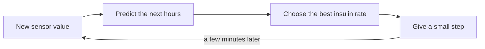

# How the pump decides on its own

In Auto mode the pump no longer follows a fixed basal rate. An app reads the sensor, decides how much insulin is needed right now, and tells the pump. It does that again and again, day and night. This page explains how such a system thinks.

<figure class="panel" data-fig="compare" data-lines="Auto mode|Fixed basal rate">
<figcaption><strong>The same two weeks, with and without Auto mode</strong>Same meals and boluses. Auto mode brings the highs after meals down. In this virtual patient it also adds time below range, which is why the safety rules below matter.</figcaption>
</figure>

## It looks ahead

Insulin needs about an hour to reach its peak, so reacting to the current reading is always too late. A system that only reacts gives more insulin while the sugar rises, keeps giving while the earlier insulin is still on its way, and ends in a low.

So the system looks ahead instead. Every few minutes it does the same thing:

1. Read the newest sensor value.
2. Predict how the sugar will move over the next hours, taking into account the insulin already given and the food you entered.
3. Work out which insulin rate would bring the sugar to the target along that prediction.
4. Give only the first small step of that plan.
5. Start over with the next reading.

The plan is thrown away every time and made again with fresh data. The system only has to be right about the next few minutes, and it can change its mind as soon as the sugar does something unexpected.

## It doesn't rush

A system that tried to fix a high reading at once would push a lot of insulin, and that insulin would still be working when the sugar is already back down. So the system plans a gradual way down to the target instead of a straight drop. It accepts a high that lasts a bit longer to avoid a low later.

## It has a picture of you

To predict, the system carries a simplified picture of your body: how fast insulin arrives, how strongly you react to it, how food turns into sugar. It starts from your weight and your usual daily insulin, and it keeps learning from your data: the insulin given, the sensor values and the meals all update its picture of how sensitive you are. Routine activity, like a walk every morning, ends up in that picture too.

The picture is never perfect, so the system checks it against every new reading. One odd reading moves it only a little, because sensors are sometimes off. Readings that keep pointing the same way move it a lot. The system also keeps several guesses at once, for example "a quiet hour" and "something unexpected is happening, maybe a meal nobody entered", and trusts whichever explains the recent readings best.

## Safety comes first

- The highest insulin rate is limited for each person.
- When the sugar is low or falling fast, the system cuts insulin further.
- Carbs logged as a hypo treatment get no insulin.
- A meal marked as slowly absorbed gets its insulin over three to four hours, as the sugar rises.

## The target

The system aims for a personal target, 5.8 mmol/L (about 105 mg/dL) unless you set your own. It can differ by time of day, in half-hour blocks. A higher target means fewer lows and more time above range. A lower one means the opposite.

## Meals still need a bolus

Food reaches the blood faster than insulin does (see [from plate to blood](food.md)). If the system waited for the sugar to rise before giving meal insulin, it would always be behind. A meal bolus gives the insulin a head start. In Auto mode the bolus covers only the carbs: highs are the automatic system's job.

## Boost and Ease-off

Sometimes you know something the system can't see yet.

**Boost** is for times when you need more insulin than usual: illness, stress, hormones, steroids. The system gives about a third more insulin while the sugar is above target, and still cuts back when it falls. Used for more than about 9 hours, Boost can push the time below range over 4%.

**Ease-off** is for times when you need less insulin: sport, a long walk, a day of gardening, alcohol, hot weather, illness with vomiting or diarrhoea, the start of a period. The system aims higher and gives less. Activity makes the body more sensitive to insulin, and insulin given before it is still working during it, so Ease-off works best when started 60 to 90 minutes before the activity. Used for more than about 9 hours, Ease-off can push the time above 10 mmol/L over 30%.
