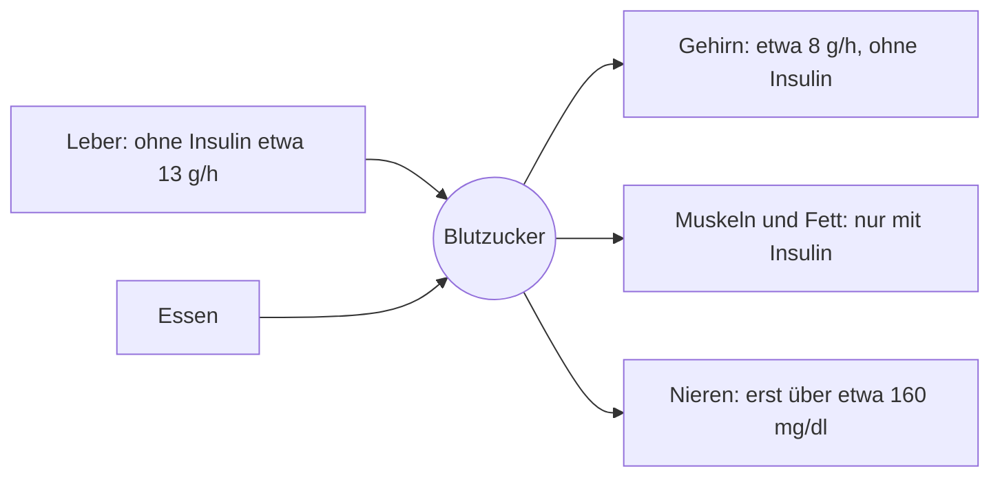

# Woher der Blutzucker kommt

Blutzucker ist ein Gleichgewicht. Zucker fließt aus der Leber und aus dem Essen ins Blut, und er fließt hinaus ins Gehirn, in die Muskeln und ins Fettgewebe. Die Zahl auf Ihrem Sensor ist das, was dieses Gleichgewicht gerade im Blut übrig lässt.

## Die Leber bildet den ganzen Tag Zucker

Die Leber speichert Zucker und gibt ihn ins Blut ab, Tag und Nacht, ob Sie essen oder nicht. So bleibt das Gehirn auch im Schlaf versorgt. Insulin bremst die Leber: Je mehr Insulin im Blut ist, desto weniger Zucker gibt sie ab, und mit genug Insulin hört sie ganz auf.

Ganz ohne Insulin gibt die Leber eines 70 kg schweren Erwachsenen etwa 13 g Zucker pro Stunde ab. Bei 50 kg sind es etwa 9 g. Das ist wie ein kleiner Snack jede Stunde, ohne etwas zu essen.

Genau dafür ist das Basalinsulin da, das gleichmäßige Hintergrund-Insulin, das Ihre Pumpe ständig abgibt. Es hält die Leber in Schach. Das Insulin zum Essen ist eine eigene Aufgabe.

## Das Gehirn nimmt sich Zucker, ohne zu fragen

Gehirn und rote Blutkörperchen verbrauchen Zucker, ohne Insulin zu brauchen. Sie nehmen eine recht gleichmäßige Menge, etwa 8 g pro Stunde bei einem 70 kg schweren Erwachsenen, und diese Menge ändert sich kaum, ob der Zucker normal oder hoch ist. Nur wenn der Zucker niedrig wird, sinkt ihr Verbrauch etwas.

Ohne Insulin geht die Rechnung also nicht auf: Die Leber gibt etwa 13 g pro Stunde hinein, das Gehirn holt etwa 8 g heraus. Der Rest bleibt im Blut. Deshalb steigt der Blutzucker bei Typ-1-Diabetes nachts, wenn Basalinsulin fehlt, auch ohne Essen.

## Muskeln und Fett brauchen Insulin

Der größte Teil des Zuckers aus einer Mahlzeit landet in Muskeln und Fettgewebe. Diese Zellen nehmen Zucker nur auf, wenn Insulin es ihnen sagt. Insulin bringt den Zucker aus dem Blut ins Gewebe und hilft dem Gewebe dann, ihn zu verbrauchen oder zu speichern. Beide Schritte hängen von Insulin ab, beide stehen auf der Seite [Wie Insulin wirkt](insulin.md).

## Die Nieren sind ein Sicherheitsventil

Die Nieren reinigen das Blut und halten den Zucker normalerweise vollständig zurück. Über etwa 160 mg/dl (9 mmol/l) schaffen sie das nicht mehr, und der überschüssige Zucker geht mit dem Urin verloren. Je höher der Zucker, desto mehr.

Darum hört sehr hoher Zucker nach einer Weile oft von selbst auf zu steigen, und darum macht hoher Zucker durstig und lässt einen öfter auf die Toilette gehen: Der Zucker nimmt Wasser mit.

## Die Körpergröße zählt

Zucker verteilt sich im Blut und in der Flüssigkeit um die Zellen. Ein kleinerer Körper hat weniger davon, also steigt der Wert bei derselben Menge Zucker stärker. 30 g Kohlenhydrate heben den Zucker eines 50 kg schweren Menschen stärker als den eines 90 kg schweren, wenn alles andere gleich ist.

## Der Ruhepunkt

Wenn niemand isst und das Basalinsulin genau passt, gibt die Leber so viel hinein, wie der Körper herausnimmt, und der Zucker bleibt flach. Das ist das Ziel des Basalinsulins: eine flache Linie über Nacht und zwischen den Mahlzeiten. Steigt die Linie nachts ohne Essen langsam an, ist für diese Zeit zu wenig Basalinsulin da. Fällt sie, ist es zu viel.

Der Körper braucht nicht den ganzen Tag gleich viel. Hormone, Bewegung und Krankheit verändern, wie stark der Körper auf Insulin reagiert, manchmal innerhalb von Stunden. Deshalb erlaubt eine Pumpe unterschiedliche Basalraten und Faktoren für verschiedene Tageszeiten.

Zahlen für einen 70 kg schweren Erwachsenen ohne Insulin.

Weiter: [Vom Teller ins Blut](food.md).
