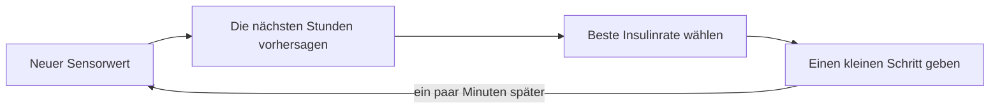

# Wie die Pumpe selbst entscheidet

Im Auto-Modus folgt die Pumpe keiner festen Basalrate mehr. Eine App liest den Sensor, entscheidet, wie viel Insulin gerade nötig ist, und sagt es der Pumpe. Das macht sie immer wieder, Tag und Nacht. Diese Seite erklärt, wie so ein System denkt.

<figure class="panel" data-fig="compare" data-lines="Auto-Modus|Feste Basalrate">
<figcaption><strong>Dieselben zwei Wochen, mit und ohne Auto-Modus</strong>Dieselben Mahlzeiten und Boli. Der Auto-Modus drückt die Hochs nach den Mahlzeiten. Bei diesem virtuellen Patienten bringt er aber auch mehr Zeit unter dem Zielbereich. Deshalb zählen die Sicherheitsregeln weiter unten.</figcaption>
</figure>

## Es schaut voraus

Insulin braucht etwa eine Stunde bis zu seinem Höhepunkt, also kommt jede Reaktion auf den aktuellen Wert zu spät. Ein System, das nur reagiert, gibt mehr Insulin, solange der Zucker steigt, gibt weiter, während das frühere Insulin noch unterwegs ist, und landet in einem Tief.

Deshalb schaut das System voraus. Alle paar Minuten macht es dasselbe:

1. Den neuesten Sensorwert lesen.
2. Vorhersagen, wie sich der Zucker in den nächsten Stunden bewegt, mit dem schon gegebenen Insulin und dem eingetragenen Essen.
3. Ausrechnen, welche Insulinrate den Zucker entlang dieser Vorhersage zum Zielwert bringt.
4. Nur den ersten kleinen Schritt dieses Plans umsetzen.
5. Mit dem nächsten Wert von vorn beginnen.

Der Plan wird jedes Mal verworfen und mit frischen Daten neu gemacht. Das System muss nur für die nächsten Minuten richtig liegen, und es kann umdenken, sobald der Zucker etwas Unerwartetes tut.

## Es hat es nicht eilig

Ein System, das einen hohen Wert sofort beheben will, würde viel Insulin geben, und dieses Insulin wirkt noch, wenn der Zucker längst wieder unten ist. Deshalb plant das System einen allmählichen Weg zum Zielwert statt eines steilen Abfalls. Es nimmt ein Hoch, das etwas länger dauert, in Kauf, um ein Tief danach zu vermeiden.

## Es hat ein Bild von Ihnen

Für die Vorhersage trägt das System ein vereinfachtes Bild Ihres Körpers mit sich: wie schnell Insulin ankommt, wie stark Sie darauf reagieren, wie aus Essen Zucker wird. Es startet mit Ihrem Gewicht und Ihrer üblichen Tagesinsulinmenge und lernt dann aus Ihren Daten weiter: Das gegebene Insulin, die Sensorwerte und die Mahlzeiten passen sein Bild davon an, wie empfindlich Sie sind. Regelmäßige Bewegung, etwa ein Spaziergang jeden Morgen, landet ebenfalls in diesem Bild.

Das Bild ist nie perfekt, deshalb prüft das System es an jedem neuen Wert. Ein einzelner seltsamer Wert verschiebt es nur wenig, weil Sensoren manchmal danebenliegen. Werte, die immer wieder in dieselbe Richtung zeigen, verschieben es stark. Außerdem hält das System mehrere Vermutungen gleichzeitig, zum Beispiel "eine ruhige Stunde" und "da passiert gerade etwas Unerwartetes, vielleicht eine Mahlzeit, die niemand eingetragen hat", und vertraut der, die die letzten Werte am besten erklärt.

## Sicherheit zuerst

- Die höchste Insulinrate ist für jeden Menschen begrenzt.
- Wenn der Zucker niedrig ist oder schnell fällt, nimmt das System noch mehr Insulin zurück.
- Kohlenhydrate, die als Hypo-Behandlung eingetragen sind, bekommen kein Insulin.
- Eine Mahlzeit, die als langsam aufgenommen markiert ist, bekommt ihr Insulin über drei bis vier Stunden, wenn der Zucker steigt.

## Der Zielwert

Das System zielt auf einen persönlichen Zielwert, 5,8 mmol/l (etwa 105 mg/dl), solange Sie keinen eigenen festlegen. Er kann je nach Tageszeit verschieden sein, in Halbstundenblöcken. Ein höherer Zielwert bedeutet weniger Tiefs und mehr Zeit über dem Bereich. Ein niedrigerer das Gegenteil.

## Mahlzeiten brauchen trotzdem einen Bolus

Essen kommt schneller im Blut an als Insulin (siehe [Vom Teller ins Blut](food.md)). Würde das System warten, bis der Zucker steigt, bevor es Insulin fürs Essen gibt, wäre es immer zu spät. Ein Essensbolus gibt dem Insulin einen Vorsprung. Im Auto-Modus deckt der Bolus nur die Kohlenhydrate ab: Um Hochs kümmert sich das automatische System.

## Boost und Ease-off

Manchmal wissen Sie etwas, das das System noch nicht sehen kann.

**Boost** ist für Zeiten, in denen Sie mehr Insulin brauchen als sonst: Krankheit, Stress, Hormone, Kortison. Das System gibt etwa ein Drittel mehr Insulin, solange der Zucker über dem Zielwert liegt, und nimmt trotzdem zurück, wenn er fällt. Länger als etwa 9 Stunden genutzt, kann Boost die Zeit unter dem Bereich über 4 % treiben.

**Ease-off** ist für Zeiten, in denen Sie weniger Insulin brauchen: Sport, ein langer Spaziergang, ein Tag Gartenarbeit, Alkohol, heißes Wetter, Krankheit mit Erbrechen oder Durchfall, der Beginn der Periode. Das System zielt höher und gibt weniger. Bewegung macht den Körper empfindlicher für Insulin, und Insulin, das vorher gegeben wurde, wirkt währenddessen noch. Deshalb wirkt Ease-off am besten, wenn es 60 bis 90 Minuten vor der Bewegung startet. Länger als etwa 9 Stunden genutzt, kann Ease-off die Zeit über 10 mmol/l über 30 % treiben.
