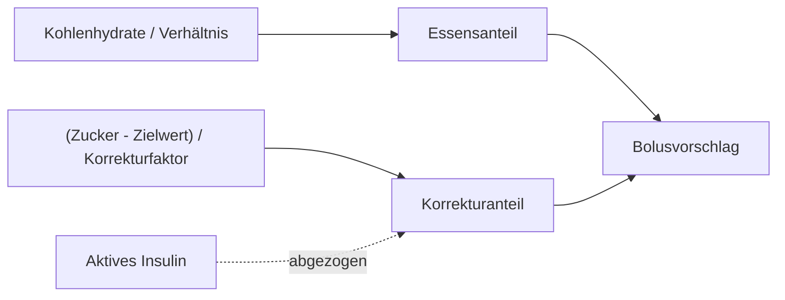

# Kohlenhydratverhältnis, Korrekturfaktor, Zielwert

Eine Pumpe mit Bolusrechner berechnet jeden Bolus aus ein paar persönlichen Zahlen. Jede Zahl beschreibt eine Sache an Ihrem Körper. Wenn der Bolus zu einer bestimmten Tageszeit regelmäßig zu groß oder zu klein ist, liegt es meist an einer dieser Zahlen.

<figure class="panel" data-fig="dosing" data-lines="Verhältnis zu hoch: 70 % des Insulins|Verhältnis richtig|Verhältnis zu niedrig: 130 % des Insulins">
<figcaption><strong>Eine Mahlzeit mit 60 g, drei Kohlenhydratverhältnisse</strong>Start bei 100 mg/dl, Auto-Modus aus, nur der Bolus wirkt. Zu wenig Insulin lässt den Zucker noch Stunden später hoch. Zu viel endet in einer Unterzuckerung.</figcaption>
</figure>

## Kohlenhydratverhältnis: Insulin fürs Essen

Das Kohlenhydratverhältnis (in der App: insulin-to-carb ratio) sagt, wie viele Gramm Kohlenhydrate eine Einheit Insulin abdeckt. Ein Verhältnis von 12 bedeutet 1 IE für je 12 g Kohlenhydrate, eine Mahlzeit mit 60 g braucht also 5 IE.

Das Verwirrende: Eine größere Zahl bedeutet weniger Insulin. Ein Verhältnis von 15 ergibt für dieselben 60 g nur 4 IE, ein Verhältnis von 10 ergibt 6 IE. Achtung: Der in Deutschland übliche KE-Faktor ist genau umgekehrt, Einheiten pro KE (10 g). Dort bedeutet eine größere Zahl mehr Insulin.

- Verhältnis zu hoch (zu wenig Insulin): Der Zucker ist 2 bis 4 Stunden nach dem Essen noch hoch.
- Verhältnis zu niedrig (zu viel Insulin): Der Zucker fällt nach dem Essen unter den Zielwert, oft erst ein paar Stunden später.

## Korrekturfaktor: Insulin gegen ein Hoch

Der Korrekturfaktor sagt, wie weit eine Einheit Insulin Ihren Zucker senkt, zum Beispiel 50 mg/dl pro Einheit. Liegen Sie bei 210 und Ihr Zielwert ist 110, sind Sie 100 darüber, und mit einem Faktor von 50 braucht das 2 IE.

Auch hier gilt: Eine größere Zahl bedeutet weniger Insulin.

- Faktor zu hoch: Korrekturen bringen den Zucker nicht weit genug herunter.
- Faktor zu niedrig: Korrekturen schießen über und enden in einem Tief.

## Zielwert: worauf der Bolus zielt

Der Bolus-Zielwert ist der Zuckerwert, auf den der Rechner zielt. Darüber rechnet er eine Korrektur dazu. Darunter wird die Korrektur negativ und macht den Essensbolus kleiner. Erlaubt sind 4,4 bis 11,0 mmol/l, also etwa 80 bis 198 mg/dl.

Im Auto-Modus gibt es einen zweiten Zielwert: den, auf den die automatische Abgabe zielt. Ohne persönliche Einstellung sind das 5,8 mmol/l, etwa 105 mg/dl. Die beiden Zielwerte sind getrennte Einstellungen und dürfen verschieden sein.

## Die Teile eines Bolus

Ein Beispiel mit Verhältnis 12, Faktor 50 und Zielwert 110. Sie essen 60 g Kohlenhydrate bei einem Zucker von 210, und von einem früheren Bolus sind noch 0,5 IE aktiv:

1. Essensanteil: 60 / 12 = 5 IE.
2. Korrekturanteil: (210 - 110) / 50 = 2 IE.
3. Das aktive Insulin geht von der Korrektur ab: 2 - 0,5 = 1,5 IE. Vom Essensanteil geht es nie ab, denn das Essen braucht sein eigenes Insulin.
4. Vorschlag: 5 + 1,5 = 6,5 IE, gerundet auf die 0,1-IE-Schritte der Pumpe.

Dieselbe Mahlzeit bei einem Zucker von 85: Die Korrektur ist (85 - 110) / 50 = -0,5 IE, und der Vorschlag sinkt auf 4,5 IE.

Ein paar Grenzen gibt es dabei:

- **Minimaler Glukosewert.** Darunter, zum Beispiel unter 70 mg/dl, macht der Rechner gar keinen Vorschlag. Ein Tief braucht zuerst Kohlenhydrate.
- **Maximaler Bolus.** Kein Vorschlag geht darüber.
- **Auto-Modus.** Ist der Auto-Modus an, deckt ein Essensbolus nur die Kohlenhydrate ab. Der aktuelle Zucker wird nicht verwendet, um Hochs kümmert sich die automatische Abgabe.

## Verschiedene Zahlen für verschiedene Zeiten

Der Körper braucht nicht den ganzen Tag gleich viel Insulin. Deshalb lässt sich jede dieser Zahlen in Zeitblöcken einstellen, in Halbstundenschritten. Wenn der Zucker nach dem Frühstück an den meisten Tagen hoch ist, nach dem Abendessen aber nicht, stimmt der Morgenblock nicht, nicht der ganze Tag.
