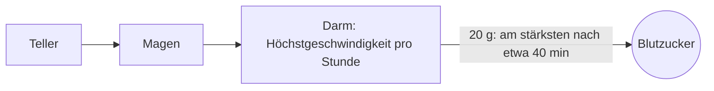

# Vom Teller ins Blut

Kohlenhydrate sind Zucker in verschiedener Verpackung: Stärke in Brot und Nudeln, Zucker in Obst und Süßigkeiten. Der Darm zerlegt sie in einzelne Zuckermoleküle und gibt sie ins Blut. Aus einem Gramm Kohlenhydrate wird etwa ein Gramm Zucker im Blut. Das Kohlenhydratverhältnis und diese Seiten zählen nur Kohlenhydrate.

## Wie schnell er ankommt

Verdauung geht nicht sofort. Das Essen liegt erst im Magen und wandert dann durch den Darm, und der Zucker kommt über eine längere Zeit verteilt im Blut an. Bei einer kleinen Menge wie 20 g ist der Zufluss ins Blut etwa 40 Minuten nach dem Essen am stärksten, die Hälfte ist nach etwa einer Stunde angekommen, das meiste nach etwa zweieinhalb Stunden.

Zum Vergleich: Ein Bolus braucht etwa eine Stunde, bis er im Blut am höchsten ist (siehe [Wie Insulin wirkt](insulin.md)). Essen ist schneller als Insulin. Das ist der Hauptgrund für die Spitze nach dem Essen, auch wenn die Dosis gestimmt hat: Der Zucker kommt zuerst, das Insulin holt später auf.

## Eine große Mahlzeit kommt länger an, nicht schneller

Der Darm hat eine Höchstgeschwindigkeit. Er kann pro Stunde nur eine bestimmte Menge Zucker ins Blut abgeben, und diese Höchstgeschwindigkeit wächst mit der Körpergröße: grob 15 g Kohlenhydrate pro Stunde bei 50 kg, etwa 22 g pro Stunde bei 75 kg. Eine größere Mahlzeit flutet nicht schneller an. Sie kommt länger an.

Wie lange es dauert, bis das meiste der Mahlzeit (90 %) angekommen ist:

| Mahlzeit | 50 kg | 75 kg |
|---|---|---|
| 20 g | 2 h 35 min | 2 h 35 min |
| 50 g | 3 h 15 min | 2 h 40 min |
| 80 g | 4 h 45 min | 3 h 25 min |
| 120 g | 6 h 55 min | 4 h 45 min |

Das erklärt ein häufiges Muster: Nach einer großen Mahlzeit bleibt der Zucker bis in den Nachmittag oder die Nacht hoch, lange nachdem der Bolus den größten Teil seiner Arbeit getan hat. Das Insulin war weg, bevor das Essen weg war.

Manche Mahlzeiten werden noch langsamer verdaut. Wenn die App eine Mahlzeit als langsam aufgenommen markieren lässt, kommt das Insulin dafür nach und nach über die nächsten drei bis vier Stunden statt auf einmal.

## Dieselbe Mahlzeit, ein anderes Ergebnis

Auch dieselbe Mahlzeit auf demselben Teller bringt nie zweimal denselben Anstieg. Wie viel davon im Blut ankommt, schwankt von Tag zu Tag, oft um etwa ein Fünftel nach oben oder unten. Dazu ein KH-Schätzwert, der ein paar Gramm daneben liegt, und zwei gleich aussehende Tage können ganz verschieden enden. Ein einzelnes Hoch nach dem Essen sagt wenig. Dasselbe Hoch nach derselben Mahlzeit an mehreren Tagen sagt etwas.

## Kohlenhydrate gegen eine Unterzuckerung

Kohlenhydrate gegen ein Tief sind etwas anderes als eine Mahlzeit: Sie sollen den Zucker heben, also sollen sie kein Insulin bekommen. Wenn Sie sie als Hypo-Behandlung eintragen, weiß ein automatisches System, dass es dafür kein Insulin geben soll.

## Körpergröße

Dieselben 30 g Kohlenhydrate heben den Zucker eines kleineren Menschen stärker als den eines größeren, weil sich der Zucker in weniger Körperflüssigkeit verteilt. Das ist ein Grund, warum Kohlenhydratverhältnisse von Mensch zu Mensch so verschieden sind.

Weiter: [Wie Insulin wirkt](insulin.md).
