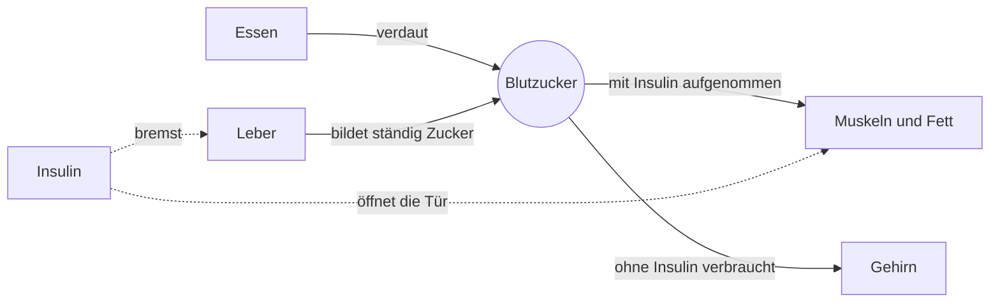

# Typ-1-Diabetes von innen

Diese Seiten erklären, was bei Typ-1-Diabetes im Körper passiert: woher der Blutzucker kommt, wie aus Essen Zucker wird, wie Insulin ihn wieder senkt, und warum dieselbe Mahlzeit und dieselbe Dosis nie zweimal dasselbe Ergebnis bringen. Sie sind für Menschen geschrieben, die mit der Krankheit leben. Mathe braucht man dafür nicht.

<figure class="panel" data-fig="day" data-lines="Typischer Tag">
<figcaption><strong>Zwei Wochen eines virtuellen Patienten</strong>Jeden Tag dieselben vier Mahlzeiten, jede mit Bolus, Auto-Modus an. Der Körper reagiert jeden Tag ein bisschen anders.</figcaption>
</figure>

## Die Kurzfassung

Im Blut ist immer etwas Zucker. Er ist der Brennstoff für Gehirn und Muskeln. Die Leber gibt rund um die Uhr Zucker ab, das Essen bringt mehr, und die Körperzellen nehmen ihn wieder heraus. Insulin ist das Signal, das beide Seiten steuert: Es sagt den Zellen, dass sie Zucker aufnehmen sollen, und es sagt der Leber, dass sie weniger abgeben soll.

Bei Typ-1-Diabetes bildet der Körper kein Insulin mehr. Der Zucker kommt weiter herein, aus der Leber und aus dem Essen, aber das Signal, ihn herauszuholen, fehlt. Jede Behandlung, ob Spritze, Pumpe oder eine Pumpe, die selbst dosiert, ersetzt dieses fehlende Signal von außen.

Das Schwierige ist das Timing. Insulin unter der Haut braucht etwa eine Stunde, bis es im Blut am höchsten ist, und das Essen kommt nach seinem eigenen Zeitplan im Blut an. Die meisten Hochs und Tiefs entstehen, weil diese beiden Zeitpläne nicht zusammenpassen.

## Die Bilder lesen

Die Bilder auf diesen Seiten sind so gezeichnet, wie ein Klinikbericht zwei Wochen Sensorwerte zeigt. Das grüne Band ist der Zielbereich, 70 bis 180 mg/dl. Die dicke Linie ist der typische Tag: zu jeder Uhrzeit lag die Hälfte der Tage darunter und die Hälfte darüber. Das graue Band zeigt, wo die mittlere Hälfte der Tage lag. Ein breites Band heißt, die Tage waren sehr verschieden. Striche am unteren Rand markieren die Mahlzeiten.

Der Balken oben auf jeder Seite fasst dieselben zwei Wochen zusammen. Grün ist die Zeit im Zielbereich, Gelb und Orange die Zeit darüber, Rot mit Streifen die Zeit darunter.

Keine dieser Kurven stammt von einem echten Menschen. Sie stammen von einem virtuellen Patienten, einem Computermodell des Körpers, das an veröffentlichter Forschung geprüft ist.

## Die Seiten

- [Woher der Blutzucker kommt](body.md): Leber, Gehirn, Muskeln und Nieren, und warum der Zucker ohne Insulin steigt, auch wenn man nichts isst.
- [Vom Teller ins Blut](food.md): wie schnell Kohlenhydrate ankommen, warum eine große Mahlzeit länger statt schneller ankommt, und warum dieselbe Mahlzeit schwankt.
- [Wie Insulin wirkt](insulin.md): wie lange es braucht, seine drei Aufgaben im Körper, wie lange es wirklich wirkt, und was die Aufnahme verändert.
- [Kohlenhydratverhältnis, Korrekturfaktor, Zielwert](dosing.md): die Zahlen in Ihrer Pumpe, was jede bedeutet, und wie ein Bolus zusammengesetzt wird.
- [Wie die Pumpe selbst entscheidet](brain.md): was ein automatisches Insulinsystem rund um die Uhr tut, und wann Boost und Ease-off helfen.
- [Der Sensor](sensor.md): was Ihr Sensorwert misst, und warum er nie genau zum Fingerpiks passt.
- [Die Zahlen in Ihrem Bericht](math-and-metrics.md): Zeit im Zielbereich und die anderen Zahlen, auf die Ihre Klinik schaut.

Jede Seite lässt sich einzeln lesen. Wer neu im Thema ist, liest sie am besten der Reihe nach.

## Zu diesen Seiten

Nichts hier ist eine medizinische Empfehlung. Die Seiten erklären, wie Körper und Behandlung funktionieren, damit Ihre eigenen Daten und die Vorschläge Ihrer Klinik mehr Sinn ergeben. Änderungen an Ihren Einstellungen besprechen Sie mit Ihrem Behandlungsteam.
