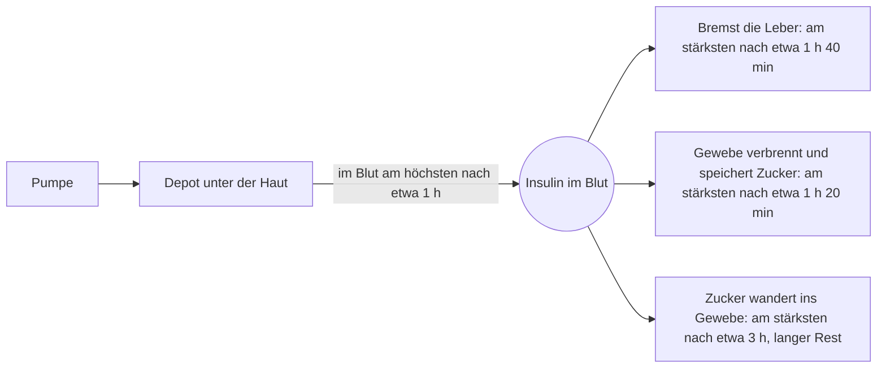

# Wie Insulin wirkt

Insulin ist das Signal, das den Zucker aus dem Blut lässt. Eine Pumpe gibt es unter die Haut, und von dort hat es einen langen Weg. Die Zahlen auf dieser Seite gelten für ein schnelles Insulin wie Fiasp aus einer Pumpe.

## Von der Haut ins Blut

Insulin aus der Pumpe geht nicht direkt ins Blut. Es bildet unter der Haut ein kleines Depot und sickert langsam daraus heraus. Im Blut ist es etwa eine Stunde nach einem Bolus am höchsten. Nach etwa drei Stunden hat fast alles (90 %) die Haut verlassen.

Im Blut selbst hält Insulin nicht lange: Die Hälfte ist nach etwa fünf Minuten abgebaut. Der Spiegel im Blut bleibt nur oben, weil das Depot unter der Haut ständig nachliefert. Deshalb wirkt ein Bolus stundenlang, obwohl Insulin im Blut so kurzlebig ist.

## Drei Aufgaben, drei Geschwindigkeiten

Im Blut macht Insulin drei verschiedene Dinge, und jedes beginnt und klingt in seinem eigenen Tempo ab:

1. **Es bremst die Leber.** Die Leber gibt weniger Zucker ab. Diese Wirkung ist etwa 1 Stunde 40 Minuten nach einem Bolus am stärksten und nach etwa 5 Stunden größtenteils vorbei.
2. **Es lässt das Gewebe Zucker verbrennen und speichern.** Muskeln und Fett verwerten den Zucker, den sie aufgenommen haben. Diese Wirkung ist die schnellste: am stärksten nach etwa 1 Stunde 20 Minuten, größtenteils vorbei nach etwa 4,5 Stunden.
3. **Es bringt Zucker aus dem Blut ins Gewebe.** Diese Wirkung ist langsam. Sie ist etwa 3 Stunden nach einem Bolus am stärksten, und nach 7,5 Stunden ist noch die Hälfte da.

Ein Bolus hat also nicht die eine "Wirkdauer". Seine Wirkung ist in den ersten zwei Stunden am stärksten, und ein langsamerer Rest reicht weit in die folgenden Stunden.

## Aktives Insulin und die Wirkdauer-Einstellung

Ihre Pumpe hat eine Einstellung namens Insulinwirkdauer, zum Beispiel 2,5 Stunden (erlaubt: 2 bis 8 Stunden). Sie sagt dem Bolusrechner, wie lange ein Bolus noch als wirksam gezählt wird. Das noch gezählte Insulin heißt aktives Insulin oder Insulin on board.

Die Einstellung ist eine Vereinfachung. Sie zieht eine harte Grenze, wo der Körper langsam ausklingt. Ist die Einstellung kürzer als der echte Rest im Körper, zählt der Rechner altes Insulin als verbraucht, obwohl es den Zucker noch senkt. Eine Korrektur ein paar Stunden nach einem Essensbolus legt dann Insulin auf Insulin, das noch wirkt, und später kann ein Tief folgen. Im Auto-Modus nutzt die automatische Abgabe diese Einstellung nicht, nur der Bolusrechner.

## Warum dieselbe Dosis nie zweimal gleich wirkt

Wie schnell Insulin die Haut verlässt und wie stark der Körper darauf reagiert, ändert sich beides. Was die Aufnahme verändert:

- **Wo und wie tief** die Kanüle sitzt.
- **Die Durchblutung** an der Stelle. Wärme und Bewegung erhöhen sie.
- **Die Menge**, die auf einmal gegeben wird.
- **Die Pumpe selbst**: Sie gibt sehr genau ab, aber nie exakt.

Was verändert, wie stark der Körper auf dasselbe Insulin reagiert:

- **Bewegung** macht den Körper empfindlicher für Insulin, während und nach der Bewegung. Auch Alltägliches wie Gartenarbeit, Einkaufen und Hausarbeit zählt.
- **Alkohol, heißes Wetter, Krankheit mit Erbrechen oder Durchfall und der Beginn der Periode** können Tiefs wahrscheinlicher machen.
- **Krankheit, Schmerzen, Stress, Hormone und Medikamente wie Kortison** können Hochs verursachen.
- **Die Tageszeit.** Auch ohne besonderen Anlass schwankt die Reaktion des Körpers auf Insulin um ein paar Prozent im Lauf weniger Stunden.

Eine verstopfte Kanüle oder ein defektes Set sieht aus wie Insulinresistenz: Der Zucker steigt weiter, egal wie viel die Pumpe abgibt, weil das Insulin nie ankommt.

Weiter: [Kohlenhydratverhältnis, Korrekturfaktor, Zielwert](dosing.md).
