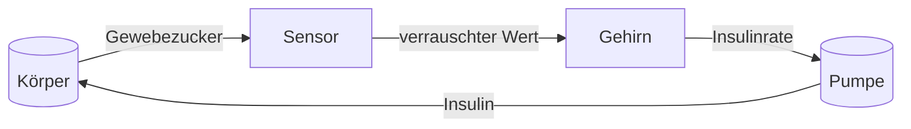

# Der Sensor

Diese Seite erklärt, was Ihr CGM-Wert wirklich ist und warum er nie ganz dem entspricht, was Sie erwarten.

## Woher der Wert kommt

Ihr Sensor misst kein Blut. Er liegt unter der Haut im Gewebe und liest den Zucker aus der Flüssigkeit zwischen den Zellen, der Gewebeflüssigkeit (interstitielle Flüssigkeit). Zucker wandert vom Blut in diese Flüssigkeit; beide liegen nahe beieinander, sind aber nie identisch. Ändert sich der Blutzucker, folgt die Gewebeflüssigkeit mit Verzögerung; deshalb hinkt der Sensorwert dem Blut ein paar Minuten hinterher.

Das Modell bildet genau das ab: Das Körpermodell hat ein Glukose-Kompartiment für das Blut und ein separates, kleineres für die Gewebeflüssigkeit. Der Sensor liest das Gewebe, denn genauso ist es im echten Leben.

## Der Wert ist ungefähr

Der Sensorwert setzt sich aus dem echten Gewebezucker und einer Abweichung zusammen. Das Fehlermodell stammt von Breton und Kovatchev (2008), die es an einem älteren Abbott-Sensor gemessen haben, dem FreeStyle Navigator. Für den Libre 3 gibt es noch kein veröffentlichtes Modell, das hier ist das nächstliegende. Es hat drei Eigenschaften:

- **Größe.** Ein Wert weicht im Mittel um etwa 11 mg/dL ab (eine Standardabweichung). Die meisten Werte liegen also innerhalb von etwa 20 mg/dL um den echten Wert.
- **Klebrigkeit.** Weicht der Sensor jetzt ab, weicht er 15 Minuten später meist in dieselbe Richtung ab. Breton hat gemessen, dass 70 % der Abweichung in den nächsten 15-Minuten-Wert mitgenommen werden. Nach einer halben Stunde ist noch etwa die Hälfte übrig.
- **Schiefe.** Der Fehler ist keine symmetrische Glockenkurve. Große Abweichungen nach oben sind häufiger als nach unten, deshalb liegt der mittlere Fehler leicht im Plus (etwa 0,7 mg/dL).

Der simulierte Sensor liefert alle 15 Minuten einen Wert, das Intervall, das Breton gemessen hat. Ihr echter Libre 3 liefert jede Minute einen.

## Ganze Zahlen und die Nullgrenze

Werte kommen als ganze mg/dL heraus, so wie Ihr Libre 3 sie exportiert. Außerdem werden sie bei Null abgeschnitten: Der Steuerung wird nie ein Zucker unter Null gemeldet, auch wenn der Rohfehler dorthin zeigt. Die Quellen nennen weder den Messbereich des Libre 3 noch, wie er LO und HI anzeigt, deshalb bildet das Modell das nicht nach.

## Wo der Sensor im Regelkreis sitzt

Der Sensorwert ist die einzige Sicht, die die Steuerung auf den Körper hat. Jede Entscheidung des Gehirns beginnt mit dieser Zahl; deshalb fällt ihre Unvollkommenheit so stark ins Gewicht.

## Gebaut für einen unvollkommenen Sensor

Der Regelkreis ist dafür gebaut, mit einem verrauschten, langsamen, klebrigen Sensor zu leben. Die Steuerung mischt den Wert mit ihrer eigenen Vorhersage, sodass eine einzelne schlechte Messung die Insulinrate nicht aus der Bahn werfen kann; eine harte Grenze schützt vor den Folgen eines zu niedrigen Werts. Genau deshalb braucht das Gehirn ein Modell. Die nächsten beiden Seiten zeigen, warum: [Der Körper](body.md) erklärt, was der Sensor misst; [Das Gehirn](brain.md), was aus der Zahl wird.