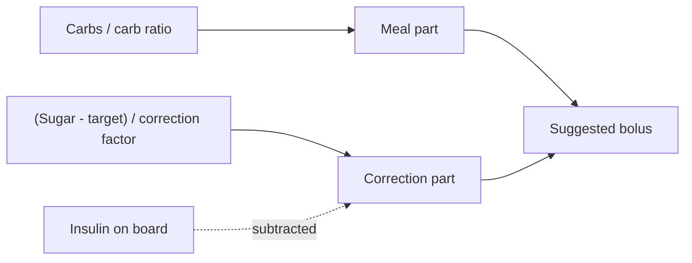

# Carb ratio, correction factor, target

A pump with a bolus calculator works out each bolus from a handful of personal numbers. Each number describes one thing about your body. When the bolus is regularly too big or too small at a certain time of day, one of these numbers is usually the reason.

## Carb ratio: insulin for food

The carb ratio says how many grams of carbs one unit of insulin covers. A ratio of 12 means 1 U for every 12 g of carbs, so a 60 g meal needs 5 U.

The confusing part: a bigger number means less insulin. A ratio of 15 gives 4 U for the same 60 g meal, a ratio of 10 gives 6 U.

- Ratio too high (too little insulin): the sugar is still high 2 to 4 hours after the meal.
- Ratio too low (too much insulin): the sugar drops below target after the meal, often a few hours later.

## Correction factor: insulin for a high

The correction factor says how far one unit of insulin lowers your sugar, for example 50 mg/dL per unit. If you are at 210 and your target is 110, you are 100 above it, and with a factor of 50 that needs 2 U.

Here too, a bigger number means less insulin.

- Factor too high: corrections don't bring the sugar down far enough.
- Factor too low: corrections overshoot and end in a low.

## Target: where the bolus aims

The bolus target is the sugar level the calculator aims for. Above it, the calculator adds a correction. Below it, the correction turns negative and makes the meal bolus smaller. The allowed range is 4.4 to 11.0 mmol/L, about 80 to 198 mg/dL.

With Auto mode there is a second target: the one the automatic delivery aims for. Without a personal setting it is 5.8 mmol/L, about 105 mg/dL. The two targets are separate settings and can differ.

## The parts of one bolus

An example with a ratio of 12, a factor of 50 and a target of 110. You eat 60 g of carbs at a sugar of 210, and 0.5 U from an earlier bolus are still on board:

1. Meal part: 60 / 12 = 5 U.
2. Correction part: (210 - 110) / 50 = 2 U.
3. Insulin on board comes off the correction: 2 - 0.5 = 1.5 U. It never comes off the meal part, because the food still needs its own insulin.
4. Suggestion: 5 + 1.5 = 6.5 U, rounded to the pump's 0.1 U steps.

Same meal at a sugar of 85: the correction is (85 - 110) / 50 = -0.5 U, and the suggestion drops to 4.5 U.

A few limits sit around this:

- **Minimum glucose.** Below it, for example 70 mg/dL, the calculator gives no suggestion at all. A low needs carbs first.
- **Maximum bolus.** No suggestion goes above it.
- **Auto mode.** With Auto mode on, a meal bolus covers only the carbs. The current sugar is not used, because the automatic delivery takes care of highs on its own.

## Different numbers for different times

The body's need for insulin is not the same all day. That is why each of these numbers can be set in time blocks, in half-hour steps. When the sugar runs high after breakfast on most days but not after dinner, it is the morning block that is off, not the whole day.

Next: [how the pump decides on its own](brain.md).
