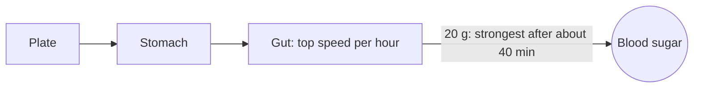

# From plate to blood

Carbohydrates are sugar in different packaging: starch in bread and pasta, sugar in fruit and sweets. The gut breaks them down into single sugar molecules and passes them into the blood. One gram of carbs becomes about one gram of sugar in the blood. Carb ratios and the pages here count carbs only.

## How fast it arrives

Digestion is not instant. The food first sits in the stomach and then moves through the gut, and the sugar arrives in the blood spread out over time. For a small amount like 20 g, the flow into the blood is strongest about 40 minutes after eating, half has arrived after about an hour, and most of it after about two and a half hours.

Compare that with insulin: a bolus needs about an hour to reach its peak in the blood (see [how insulin works](insulin.md)). Food is faster than insulin. That is the main reason for the spike after a meal, even when the dose was right: the sugar comes first, the insulin catches up later.

## A big meal arrives longer, not faster

The gut has a top speed. It can only pass so much sugar into the blood per hour, and that top speed grows with body size: roughly 15 g of carbs per hour at 50 kg, about 22 g per hour at 75 kg. A bigger meal doesn't flood in faster. It keeps arriving for longer.

How long until most of the meal (90%) has arrived:

| Meal | 50 kg | 75 kg |
|---|---|---|
| 20 g | 2 h 35 min | 2 h 35 min |
| 50 g | 3 h 15 min | 2 h 40 min |
| 80 g | 4 h 45 min | 3 h 25 min |
| 120 g | 6 h 55 min | 4 h 45 min |

This explains a common pattern: after a large meal the sugar stays high late into the afternoon or night, long after the bolus has done most of its work. The insulin was gone before the food was.

Some meals digest even more slowly than this. If the app lets you mark a meal as slowly absorbed, the insulin for it is given gradually over the next three to four hours instead of all at once.

## The same meal, a different result

Even the same meal on the same plate doesn't give the same rise twice. How much of it reaches the blood varies from day to day, often by around a fifth up or down. Add a carb count that is off by a few grams, and two identical-looking days can end very differently. One high after a meal says little. The same high after the same meal on several days says something.

## Carbs for a low

Carbs eaten to treat a low are different from a meal: they are there to raise the sugar, so they should not get insulin. If you log them as a hypo treatment, an automatic system knows not to give insulin for them.

## Body size

The same 30 g of carbs raises the sugar of a smaller person more than that of a larger person, because the sugar spreads through less body fluid. This is part of why carb ratios differ so much between people.

Next: [how insulin works](insulin.md).
