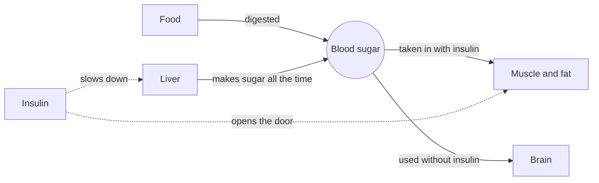

# Type 1 diabetes, from the inside

These pages explain what happens in the body with type 1 diabetes: where blood sugar comes from, how food turns into sugar, how insulin brings it back down, and why the same meal and the same dose don't give the same result twice. They are written for people who live with the illness. No maths needed.

## The short version

Your blood always carries some sugar. It is the fuel for the brain and the muscles. The liver adds sugar around the clock, food adds more, and the body's cells take it out again. Insulin is the signal that controls both sides: it tells the cells to take sugar in, and it tells the liver to make less.

In type 1 diabetes the body no longer makes insulin. The sugar keeps coming in, from the liver and from food, but the signal to take it out is missing. Every treatment, injections, a pump, a pump that doses on its own, replaces that missing signal from the outside.

The hard part is timing. Insulin under the skin needs about an hour to reach its peak in the blood, and food reaches the blood on its own schedule. Most highs and lows come from those two schedules not lining up.

## The pages

1. [Where blood sugar comes from](body.md): the liver, the brain, the muscles and the kidneys, and why sugar rises without insulin even when you don't eat.
2. [From plate to blood](food.md): how fast carbs arrive, why a big meal arrives longer instead of faster, and why the same meal varies.
3. [How insulin works](insulin.md): how long it takes, its three jobs in the body, how long it really lasts, and what changes how it is absorbed.
4. [Carb ratio, correction factor, target](dosing.md): the numbers in your pump, what each one means, and how a bolus is put together.
5. [How the pump decides on its own](brain.md): what an automatic insulin system does around the clock, and when Boost and Ease-off help.
6. [The sensor](sensor.md): what your sensor reading measures, and why it never matches the finger prick exactly.
7. [The numbers on your report](math-and-metrics.md): time in range and the other numbers your clinic looks at.

Each page can be read on its own. If you are new to this, read them in order.

## A note on these pages

Nothing here is medical advice. The pages explain how the body and the treatment work, so that your own data and your clinic's suggestions make more sense. Changes to your settings belong with your care team.
