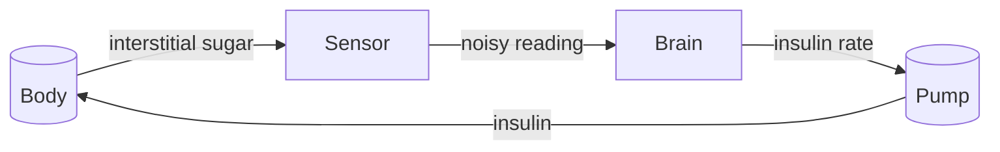

# The sensor

This page explains what your CGM reading really is, and why it never quite matches what you expect.

## Where the reading comes from

Your sensor does not measure blood. It sits under the skin, in the tissue, and reads the sugar in the fluid between the cells: the interstitial fluid. Sugar moves from the blood into that fluid, and the two are close but never identical. When blood sugar changes, the interstitial fluid follows with a delay, which is why the sensor number lags a few minutes behind the blood.

The model captures this exactly. The body model has a glucose compartment that is the blood, and a separate small compartment that is the interstitial fluid. The sensor reads the interstitial one, because that is what happens in real life.

## The reading is approximate

The sensor output is the true interstitial sugar plus an error. The error model comes from Breton and Kovatchev (2008), who measured it on an older Abbott sensor, the FreeStyle Navigator. No published model covers the Libre 3 yet, so this is the closest one available. It has three properties:

- **Size**: on average a reading is off by about 11 mg/dL (one standard deviation), so most readings are within about 20 mg/dL of the truth.
- **Stickiness**: if the sensor is off now, it tends to be off in the same direction 15 minutes later. Breton measured that 70% of the error carries over to the next 15-minute reading. After half an hour about half of it is still there.
- **Skew**: the error is not a symmetric bell curve. Big positive errors are more common than big negative ones, which is why the average error is slightly positive (about 0.7 mg/dL).

The simulated sensor gives one reading every 15 minutes, the interval Breton measured. Your real Libre 3 gives one every minute.

## Whole numbers and the zero floor

Readings come out as whole mg/dL, the way your Libre 3 exports them. They are also clamped at zero: the controller is never told the sugar is below zero, even if the raw error points there. The published sources don't give the Libre 3 measuring range or how it shows LO and HI, so the model doesn't imitate those.

## Where the sensor sits in the loop

The sensor reading is the controller's only view of the body. Everything the brain decides starts with this number, so its imperfection matters.

## Built for an imperfect sensor

The loop is built to live with a noisy, lagging, sticky sensor. The controller blends the reading with its own prediction, so a single bad sample cannot yank the insulin rate, and a hard cutoff protects against the consequences of a low reading. The sensor's imperfection is the reason the brain needs a model. The next two pages are about that: [the body](body.md) is what the sensor measures, and [the brain](brain.md) does the thinking about it.